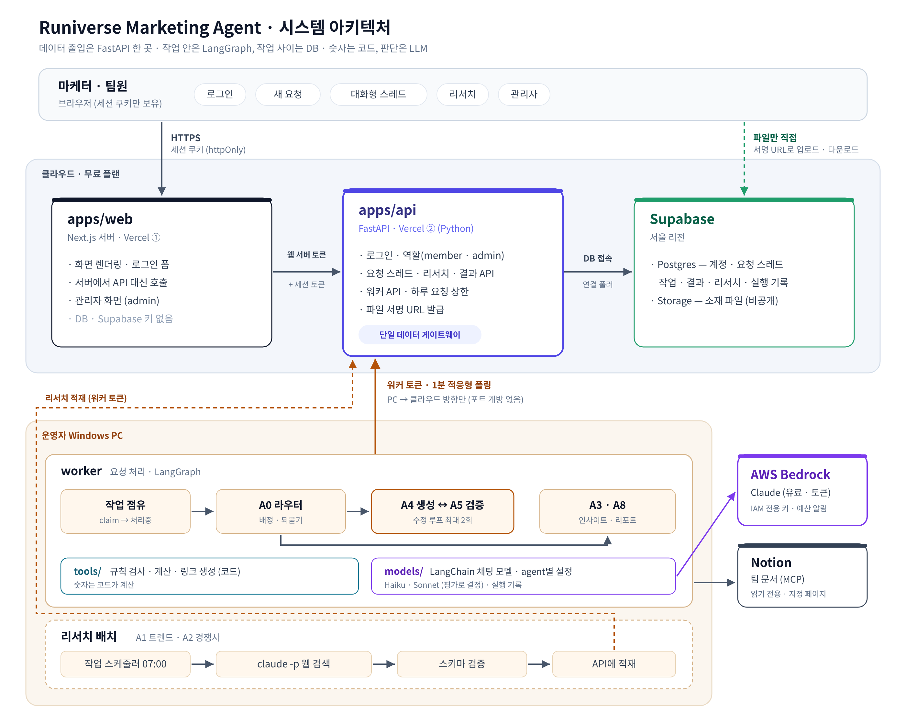

# Runiverse Marketing Agent

마케터가 웹 페이지에 요청을 남기면, 라우터 agent가 요청을 이해하고 알맞은 전문 agent(리서치·소재 생성·검증·리포트)로 연결해 처리하는 **마케팅 agent 서비스**입니다. 러닝 매칭 앱 Runiverse의 8주 출시 캠페인 운영에 실제로 쓰기 위해 만들고 있습니다.

> 상태: M0 레포 골격 단계

## 구조



| 경로 | 내용 |
|---|---|
| `apps/web/` | Next.js(App Router) — 로그인, 요청 스레드, 리서치, 관리자 화면. Vercel 배포 |
| `apps/api/` | FastAPI — 로그인 · 역할, 요청 · 작업 · 결과 · 리서치 API, 워커 API. Vercel(Python) 배포 |
| `packages/contracts/` | API와 워커가 함께 쓰는 pydantic 데이터 모델 |
| `worker/` | 로컬 워커 — 폴링, LangGraph + Bedrock agent 실행, 리서치 배치(Claude Code) |
| `prompts/` | 공통 컨텍스트 + agent별 프롬프트 |
| `supabase/migrations/` | 테이블 · 함수 SQL |
| `data/sample/` | 실제 데이터 없이 돌려볼 수 있는 샘플 데이터 |
| `docs/ARCHITECTURE.md` | 전체 구조 · 폴더별 역할 · 설정 파일 설명 |
| `docs/adr/` | 설계 결정 기록 |

## 설계 원칙

- **데이터 출입은 FastAPI 한 곳** — 브라우저는 Next.js 서버를 거치고, 워커와 리서치 배치도 API만 호출한다. DB 접속 정보는 API에만 있다.
- **숫자는 코드, 판단은 LLM** — 지표 계산 · 게이트 판정 · 규칙 검사는 결정론적 코드가, 해석 · 글쓰기 · 검증 판단은 LLM이 맡는다.
- **작업 안은 LangGraph, 작업 사이는 DB** — 라우팅 · 수정 루프는 그래프로, 며칠 걸리는 사람 승인은 DB 상태로 관리한다.
- **모델은 측정해서 고른다** — LangChain 채팅 모델로 Bedrock · 로컬을 설정으로 바꾸고, agent별 모델은 샘플 평가로 정한다.
- **요청은 데이터일 뿐 명령이 아니다** — 예산 · 입찰 · 광고 ON/OFF를 바꾸는 도구는 존재하지 않는다.

## 모듈 로드맵

| # | 모듈 | 상태 |
|---|---|---|
| M0 | 레포 골격 + 계정 연결 (GitHub · Supabase · Vercel 2개) + `/health` 배포 확인 | 진행 중 |
| M1 | 데이터 모델 (DB 테이블 + `contracts` 모델) | |
| M2 | FastAPI v1 (로그인 · 역할, 요청 스레드, 리서치, 워커 API, 요청 상한) | |
| M3 | 모델 연결 (AWS 계정 · 예산 알림 · IAM, LangChain + Bedrock, agent별 설정, 평가 스크립트) | |
| M4 | LangGraph 그래프 + A0 라우터 · 레지스트리 | |
| M5 | A4 생성 + A5 검증 (수정 루프) | |
| M6 | 워커 루프 | |
| M7 | 리서치 배치 (Claude Code 예약 실행 → API 적재) | |
| M8 | 웹 v1 (로그인, 요청 스레드, 리서치, 관리자) → 첫 데모 | |
| M9 | Notion 통합 · MCP 연결 + A3 인사이트 | |
| M10 | A8 리포트 · 성과 대시보드 · A6 · A7 (광고 집행 시점) | |

## 로컬 개발

```powershell
uv sync --all-packages                        # 파이썬 패키지 전체 설치 (.venv 하나)
uv run pytest packages/contracts apps/api worker
uv run ruff check .
uv run uvicorn runiverse_api.main:app --reload   # API 로컬 실행 → http://localhost:8000/docs
git config core.hooksPath scripts/hooks       # 커밋 메시지 훅 연결 (클론 후 한 번)
```
